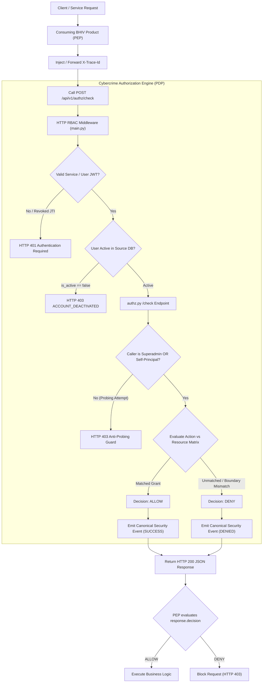
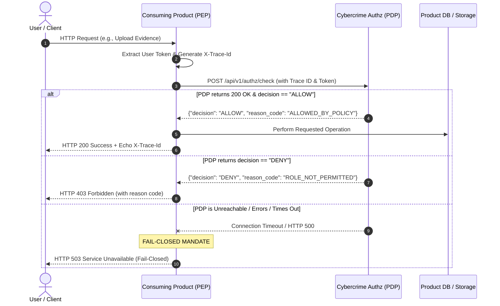

# BHIV Centralized Authorization & Cross-Product Integration Guide

**Document Identifier:** `BHIV_CENTRALIZED_AUTHORIZATION_GUIDE.md`  
**Target Audience:** Engineering Teams across all BHIV Organization Products (Cybercrime, Fraud Evidence, TANTRA, VAJRA, Plant Intelligence, External Gateways)  
**Contract Version:** `1.0.0`  
**Authority:** Cybercrime Access Control & Policy Decision Point (PDP)  
**Status:** `ACTIVE SPECIFICATION & INTEGRATION MANUAL`  

---

## 1. Executive Summary

This specification defines the unified authorization architecture across the **BHIV Ecosystem**. 

Rather than having each individual product independently define, duplicate, or drift its authorization logic, the **Cybercrime Investigation Backend** operates as the **Central Policy Decision Point (PDP)**. Every downstream BHIV product acts as a **Policy Enforcement Point (PEP)** that evaluates user and inter-service operations against Cybercrime's authorization endpoint:

```http
POST /api/v1/authz/check
```

### Core Architecture Axioms:
1. **Strict Deny-by-Default:** Any access request that is not explicitly permitted by verified policy rules is immediately rejected with `DENY` (HTTP 403 / 401).
2. **Fail-Closed Resilience:** If the authorization authority is unreachable, times out, or encounters an internal database/network failure, the consuming product **MUST NOT** fail open. Access must be refused (HTTP 503 / 403).
3. **Identity Binding & Anti-Probing:** Non-superadmin callers are restricted to querying authorization decisions for their own principal identity (`cc_usr_<id>`), preventing unauthorized security probing or role enumeration.
4. **End-to-End Auditability:** Every authorization check automatically records an immutable, canonical audit event conforming to the `Canonical Security Event v1.0.0` schema, scrubbing all sensitive credentials before persistence.

---

## 2. Architectural Blueprint



---

## 3. Two-Tier Internal Authorization Workflow

Authorization in this project operates across two complementary tiers:

### Tier 1: Gateway / HTTP Middleware Level (`main.py`)
Intercepts every HTTP request entering the Cybercrime API before reaching application routers:
1. **Trace ID Propagation:** Extracts `X-Trace-Id` from request headers (or generates a fresh UUIDv4).
2. **Token Verification:** Extracts `Bearer <token>`, verifies signature with `SECRET_KEY` and algorithm (`HS256`), and checks expiration (`exp`).
3. **Token Revocation Check (Tier 3 Revocation):** Checks whether the JWT ID (`jti`) is present in the persistent SQLite `RevokedToken` table. If revoked, the call fails immediately.
4. **Account State Verification (Tier 2 Revocation):** Queries the user in the database. If `is_active == false`, the request is rejected with `HTTP 403 ACCOUNT_DEACTIVATED`.
5. **Path & Method Verification (Tier 1 Revocation):** Evaluates requested method and path against `rbac-permissions.json` using pattern/glob matching.

### Tier 2: The Policy Decision Engine (`/api/v1/authz/check`)
Handles cross-service and granular domain-level permissions:
- Evaluates subject roles (`superadmin`, `investigator`, `public`).
- Evaluates resource types (`evidence`, `case`, `wallet`, `transaction`, `incident`, `complaint`, `watchlist`, `dashboard`).
- Evaluates actions (`read`, `create`, `update`, `delete`, `upload`, `download`, `freeze`, `unfreeze`, `verify`, `anchor`).
- Checks **Self-Boundary Isolation**: Investigators cannot read or modify cases, messages, or evidence owned by other investigators (`owner_id != actor_id`) unless granted elevated delegation.

---

## 4. API Contract: `POST /api/v1/authz/check`

### 4.1 Endpoint Specification
- **Method:** `POST`
- **URL:** `http://<CYBERCRIME_HOST>:3000/api/v1/authz/check`
- **Authentication:** `Bearer <JWT_TOKEN>` (Caller must be authenticated)
- **Content-Type:** `application/json`

### 4.2 Request Headers

| Header | Required | Type | Description |
|---|---|---|---|
| `Authorization` | **Yes** | String | `Bearer <JWT_TOKEN>` of authenticated user or service account |
| `X-Trace-Id` | **Yes** | String | Unique correlation identifier (UUIDv4) for distributed tracing |
| `Content-Type` | **Yes** | String | Must be `application/json` |

### 4.3 Request Body Schema

```json
{
  "contract_version": "1.0.0",
  "subject": {
    "actor_id": "cc_usr_8882",
    "role": "investigator",
    "is_active": true
  },
  "action": "upload",
  "resource": {
    "type": "evidence",
    "id": "EVID-2026-9901",
    "owner_id": "cc_usr_8882"
  },
  "context": {
    "source_product": "fraud-evidence-system",
    "client_ip": "192.168.1.50",
    "route": "/api/evidence/upload"
  }
}
```

#### Field Specifications:
- `contract_version` *(String, Required)*: Must strictly equal `"1.0.0"`.
- `subject.actor_id` *(String, Required)*: Principal identifier (e.g., `cc_usr_1`, `fe_usr_102`).
- `subject.role` *(String, Required)*: Must be one of `["superadmin", "investigator", "user", "public", "service_agent"]`.
- `subject.is_active` *(Boolean, Required)*: Current account state.
- `action` *(String, Required)*: Target operation (e.g., `"read"`, `"create"`, `"update"`, `"delete"`, `"upload"`, `"download"`, `"freeze"`, `"unfreeze"`, `"verify"`, `"anchor"`).
- `resource.type` *(String, Required)*: Target asset type (`"evidence"`, `"case"`, `"wallet"`, `"transaction"`, `"policy"`, `"system_config"`, `"artifact"`).
- `resource.id` *(String, Required)*: Unique resource identifier.
- `resource.owner_id` *(String, Optional)*: Owner principal for self-boundary verification.
- `context` *(Object, Optional)*: Telemetry metadata (`source_product`, `client_ip`, `route`, etc.).

---

### 4.4 Response Body Schema

The endpoint responds with **HTTP 200 OK** whenever the evaluation successfully completes, conveying the authorization verdict in the `decision` field:

```json
{
  "contract_version": "1.0.0",
  "decision": "ALLOW",
  "reason_code": "ALLOWED_BY_POLICY",
  "reason": "Investigator role authorized for action 'upload' on resource 'evidence'.",
  "trace_id": "trace-8f92b7c4a102",
  "evaluated_at": "2026-10-21T09:55:00.123Z",
  "policy_applied": "rbac_permissions_v1"
}
```

#### Decision Reason Codes:

| Reason Code | Decision | Meaning / Cause |
|---|---|---|
| `ALLOWED_BY_POLICY` | `ALLOW` | Action and resource are explicitly granted to the actor's verified role. |
| `DENIED_BY_DEFAULT` | `DENY` | No policy rule exists permitting this action/resource combination. |
| `ACCOUNT_INACTIVE` | `DENY` | Subject's account is flagged inactive or deactivated. |
| `ROLE_NOT_PERMITTED` | `DENY` | Actor's role is not authorized for the requested action. |
| `SELF_BOUNDARY_MISMATCH` | `DENY` | Actor attempted to access a private resource owned by another principal without delegation. |
| `AUTHENTICATION_REQUIRED` | `DENY` | Resource requires authenticated identity; public access is disallowed. |

---

## 5. Client Integration Procedure (Consuming Products)

Any BHIV product connecting to this authorization service must implement the following 5-step integration lifecycle:



---

### Implementation Example 1: Node.js / Express Middleware (e.g. Fraud Evidence System)

Save this as `middleware/remoteAuthz.js` in your Node.js project:

```javascript
const axios = require('axios');
const { v4: uuidv4 } = require('uuid');

/**
 * Express middleware to enforce remote authorization via Cybercrime PDP.
 * @param {string} action - Target action ('upload', 'read', 'delete', etc.)
 * @param {string} resourceType - Target resource type ('evidence', 'case', 'wallet')
 */
function requireRemoteAuthz(action, resourceType) {
  return async (req, res, next) => {
    const traceId = req.headers['x-trace-id'] || req.traceId || uuidv4();
    const token = req.headers.authorization;

    if (!token) {
      return res.status(401).json({
        error: "Unauthorized",
        message: "Authorization token is required"
      });
    }

    const payload = {
      contract_version: "1.0.0",
      subject: {
        actor_id: req.user?.id ? `cc_usr_${req.user.id}` : "cc_usr_unknown",
        role: req.user?.role || "investigator",
        is_active: req.user?.isActive !== false
      },
      action: action,
      resource: {
        type: resourceType,
        id: req.params.id || req.body.id || "default",
        owner_id: req.body.ownerId || null
      },
      context: {
        source_product: process.env.BHIV_PRODUCT_NAME || "fraud-evidence-system",
        route: req.originalUrl,
        method: req.method
      }
    };

    try {
      const response = await axios.post(
        process.env.CYBERCRIME_AUTHZ_URL || 'http://localhost:3000/api/v1/authz/check',
        payload,
        {
          headers: {
            'Authorization': token,
            'X-Trace-Id': traceId,
            'Content-Type': 'application/json'
          },
          timeout: 4000 // 4 second SLA timeout
        }
      );

      if (response.data.decision === "ALLOW") {
        req.traceId = response.data.trace_id;
        res.setHeader('X-Trace-Id', req.traceId);
        return next();
      }

      // Explicit Deny
      return res.status(403).json({
        error: "Forbidden",
        reason_code: response.data.reason_code,
        reason: response.data.reason,
        trace_id: response.data.trace_id
      });

    } catch (error) {
      // STRICT FAIL-CLOSED MANDATE:
      // If authorization authority fails or times out, never allow access!
      console.error("[PEP FAIL-CLOSED] Authorization service unreachable:", error.message);
      return res.status(503).json({
        error: "Authorization Service Unavailable",
        code: "AUTHZ_UNAVAILABLE_FAIL_CLOSED",
        trace_id: traceId
      });
    }
  };
}

module.exports = requireRemoteAuthz;
```

#### Usage in Route Declarations:
```javascript
const router = require('express').Router();
const requireRemoteAuthz = require('../middleware/remoteAuthz');

// Protected route enforcing remote authorization:
router.post('/evidence/upload', requireRemoteAuthz('upload', 'evidence'), uploadHandler);
router.post('/wallets/:id/freeze', requireRemoteAuthz('freeze', 'wallet'), freezeHandler);
```

---

### Implementation Example 2: Python / FastAPI Dependency (e.g. TANTRA / Python Microservices)

Save this as `core/remote_authz.py`:

```python
import os
import httpx
from fastapi import Header, HTTPException, Request, status

CYBERCRIME_AUTHZ_URL = os.getenv("CYBERCRIME_AUTHZ_URL", "http://localhost:3000/api/v1/authz/check")

def require_remote_authz(action: str, resource_type: str):
    async def _authz_dependency(
        request: Request,
        authorization: str = Header(..., description="Bearer JWT"),
        x_trace_id: str = Header(None, alias="X-Trace-Id")
    ):
        trace_id = x_trace_id or getattr(request.state, "trace_id", "trace-auto")
        user = getattr(request.state, "current_user", None)
        
        payload = {
            "contract_version": "1.0.0",
            "subject": {
                "actor_id": f"cc_usr_{user.id}" if user else "cc_usr_unknown",
                "role": getattr(user, "role", "investigator"),
                "is_active": getattr(user, "is_active", True)
            },
            "action": action,
            "resource": {
                "type": resource_type,
                "id": request.path_params.get("id", "default")
            },
            "context": {
                "source_product": os.getenv("BHIV_PRODUCT_NAME", "tantra-runtime"),
                "path": request.url.path,
                "method": request.method
            }
        }
        
        headers = {
            "Authorization": authorization,
            "X-Trace-Id": trace_id,
            "Content-Type": "application/json"
        }

        try:
            async with httpx.AsyncClient(timeout=4.0) as client:
                res = await client.post(CYBERCRIME_AUTHZ_URL, json=payload, headers=headers)
                
            if res.status_code == 200:
                body = res.json()
                if body.get("decision") == "ALLOW":
                    return body
                raise HTTPException(
                    status_code=status.HTTP_403_FORBIDDEN,
                    detail={
                        "error": "Forbidden",
                        "reason_code": body.get("reason_code"),
                        "reason": body.get("reason"),
                        "trace_id": body.get("trace_id")
                    }
                )
            elif res.status_code == 401:
                raise HTTPException(status_code=status.HTTP_401_UNAUTHORIZED, detail="Invalid token")
            else:
                raise HTTPException(status_code=status.HTTP_403_FORBIDDEN, detail="Access denied by PDP")

        except httpx.RequestError as exc:
            # STRICT FAIL-CLOSED MANDATE
            raise HTTPException(
                status_code=status.HTTP_503_SERVICE_UNAVAILABLE,
                detail=f"Authorization authority unreachable: {str(exc)}. Failing closed."
            )
            
    return _authz_dependency
```

#### Usage in FastAPI Routes:
```python
from fastapi import APIRouter, Depends
from core.remote_authz import require_remote_authz

router = APIRouter()

@router.post("/artifacts/upload", dependencies=[Depends(require_remote_authz("upload", "artifact"))])
async def upload_artifact(payload: dict):
    return {"status": "accepted"}
```

---

## 6. Access Revocation Protocol (`POST /api/v1/access/revoke`)

When security incidents occur or access must be immediately terminated across all products, call the central revocation endpoint:

```http
POST http://<CYBERCRIME_HOST>:3000/api/v1/access/revoke
```

### Revocation Request Body:
```json
{
  "contract_version": "1.0.0",
  "revocation_type": "token_invalidation",
  "target": {
    "actor_id": "cc_usr_8882",
    "jti": "d3b07384-d113-4ec6-8968-3e9a4f664a75"
  },
  "reason": "Suspected token leakage during investigation transfer",
  "requested_by": "cc_usr_8881"
}
```

### Revocation Types Supported:
1. `token_invalidation`: Adds the target `jti` to SQLite `RevokedToken` table. The token is immediately blocked across all BHIV products on the next request.
2. `user_deactivation`: Sets `is_active: false` on the target user in the database. All existing and future sessions for that user will return `HTTP 403 ACCOUNT_DEACTIVATED`.
3. `permission_revocation`: Modifies live RBAC roles and permissions.

---

## 7. Mandatory Implementation Rules for All Teams

| # | Rule | Requirement |
|---|---|---|
| **1** | **Strict Fail-Closed** | Consuming products must **never** proceed if the call to `/api/v1/authz/check` returns an error or times out. Catch all connection errors and return HTTP 503. |
| **2** | **Trace ID Preservation** | Forward incoming `X-Trace-Id` headers without alteration. If missing, generate a new UUIDv4 and set it on both the request and response headers. |
| **3** | **Zero Secret Transmission** | Never send passwords, private keys, or API secrets inside the `context` dictionary. Only send identifiers and metadata. |
| **4** | **Timeout SLA** | Use a client HTTP timeout between **3.0 and 5.0 seconds** to avoid hanging upstream caller connections. |
| **5** | **Cache Boundary** | If authorization decisions are cached locally for performance, cache expiration **must not exceed 60 seconds** to ensure revocations propagate quickly. |
