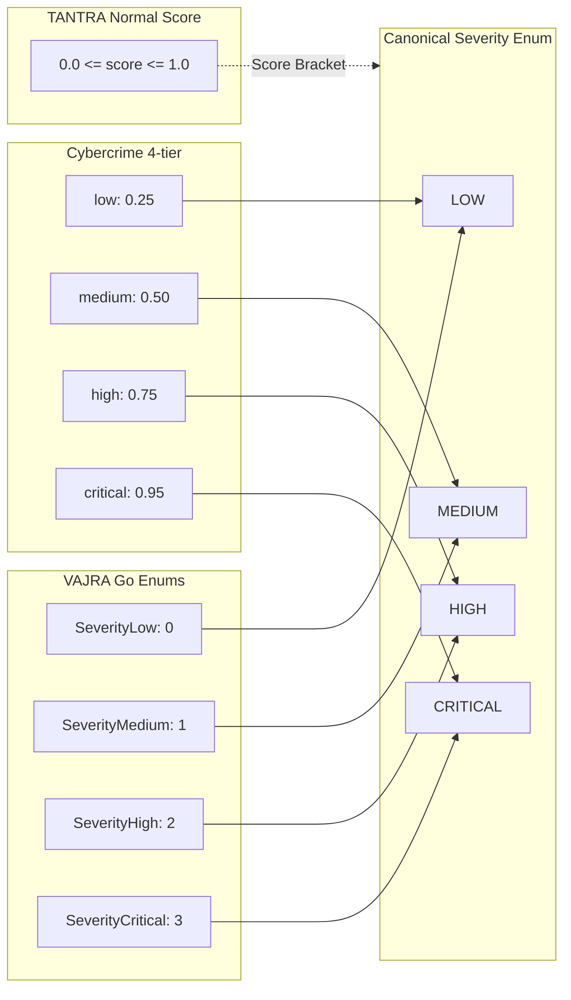

# Phase 2 — Cross-Repository Schema & API Mapping Matrix

**Document Identifier:** `PHASE_2_CROSS_REPOSITORY_MAPPING.md`  
**Document Owner:** Kaushlendra — Data, API & Access Control  
**Status:** `PROPOSED CONTRACT DESIGN`  
**Version:** `1.0.0-draft`  
**Date:** 2026-10-17  
**Scope:** Structural, Semantic, and Syntactic Mappings between Cybercrime, Fraud Evidence System, TANTRA, and VAJRA  

---

## 1. Purpose and Methodology

This document establishes the precise translation rules between existing repository-specific models and the proposed **Phase 2 Canonical Security Event Schema** ([`PHASE_2_CANONICAL_SECURITY_SCHEMA.md`](file:///c:/Users/A/Documents/CyberSecurity/PHASE_2_CANONICAL_SECURITY_SCHEMA.md)) and **Access Control Contract** ([`PHASE_2_ACCESS_CONTROL_API_CONTRACT.md`](file:///c:/Users/A/Documents/CyberSecurity/PHASE_2_ACCESS_CONTROL_API_CONTRACT.md)).

To avoid false equivalences, every mapping rule is classified into one of four designations:
- **`VERIFIED`**: Concrete implementation artifact confirmed directly in active repository source code.
- **`PROPOSED`**: Formally specified transformation rule designed to bridge repository discrepancies.
- **`NOT DEFINED`**: Concept or interface that is completely absent from the source code.
- **`PENDING TEAM AGREEMENT`**: Architectural or operational choice requiring multi-team consensus before implementation.

---

## 2. Core Entity Mappings

### 2.1 Actor / User Identifier Mappings

| Source System | Native Field & Data Type | Code Evidence | Canonical Target (`actor.actor_id`) | Mapping Classification | Rationale & Transformation Rule |
|---|---|---|---|---|---|
| **Cybercrime** | `users.id` (`Integer PK`) | [`cybercrime/backend/app/db/models.py:L15`](file:///c:/Users/A/Documents/CyberSecurity/cybercrime/backend/app/db/models.py#L15) | `"cc_usr_" + str(user.id)` | `PROPOSED` | Prepends namespace `cc_usr_` to prevent integer collisions with external system IDs. |
| **Fraud Evidence** | `User._id` (`ObjectId`) | [`fraud-evidence-system/Backend/models/User.js`](file:///c:/Users/A/Documents/CyberSecurity/fraud-evidence-system/Backend/models/User.js) | `"fe_usr_" + str(user._id)` | `PROPOSED` | Prepends namespace `fe_usr_` to the 24-character hex string. |
| **VAJRA** | `Subject` (`String`) | [`core/relay-chain/cybersecurity/security_contract.go:L102`](file:///c:/Users/A/Documents/CyberSecurity/bhiv-VAJRA_Blockchain-main/bhiv-VAJRA_Blockchain-main/core/relay-chain/cybersecurity/security_contract.go#L102) | `subject` (Direct string) | `PROPOSED` | Passed through directly; represents wallet address or role string. |
| **TANTRA** | *None* | [`Full-tantra-constitutional-convergence/api.py:L15-35`](file:///c:/Users/A/Documents/CyberSecurity/Full-tantra-constitutional-convergence/api.py#L15-L35) | `"svc_tantra_core"` | `PROPOSED` | TANTRA has no user entity; system-level actions are mapped to a service actor ID. |

---

### 2.2 Evidence and Artifact Identifier Mappings

> **CRITICAL WARNING:** Do NOT equate `evidence_id` string, MongoDB `_id` hex, and TANTRA `artifact_id` as interchangeable types. They serve fundamentally different functions in their native storage engines.

| Dimension | Cybercrime | Fraud Evidence System | TANTRA | VAJRA | Proposed Canonical Schema | Status |
|---|---|---|---|---|---|---|
| **Primary ID** | `evidence_id` (`EV-<timestamp>`) | `_id` (`ObjectId`) | `artifact_id` (`String`) | `Type` (`String`) | `resource.resource_id` (`String`) | `PROPOSED` |
| **Case Link** | `case_id` (`Integer FK`) | `caseId` (`String`) | In payload | In incident struct | `resource.case_id` (`String`) | `PENDING TEAM AGREEMENT` |
| **Target Address**| Inferred from Case | `wallet` (`String`) | In payload | `Data` (`String`) | `resource.target_address` (`String`)| `PROPOSED` |
| **Integrity Hash**| `hash` (`SHA-256`) | `storageHash` (`SHA-256`) | `hash` & `pipeline_hash` | `Hash` (`SHA-256`) | `resource.integrity_hash` (`String`)| `VERIFIED` |
| **Storage Pointers**| File path on disk | `storageMetadata` (IPFS/S3) | In payload | Not defined | `extensions.<system>.storage` | `PROPOSED` |

#### Canonical Transformation Rule for Case Linkage (`PENDING TEAM AGREEMENT`):
Because Cybercrime represents `case_id` as an internal autoincrement integer while Fraud Evidence System uses alphanumeric strings (e.g. `CAS-2026-089`), team agreement is required on whether to adopt alphanumeric strings (e.g. `CAS-<int>` for Cybercrime) as the global standard.

---

### 2.3 Timestamp Format Mappings

| Repository | Native Timestamp Format | Implementation Evidence | Serialization Quirk | Canonical Target Format (`timestamp`) | Status |
|---|---|---|---|---|---|
| **Cybercrime** | `datetime.utcnow()` | [`models.py:L124,159`](file:///c:/Users/A/Documents/CyberSecurity/cybercrime/backend/app/db/models.py#L124) | Python naive datetime (no explicit timezone offset in DB column). | ISO 8601 UTC with explicit `Z` suffix. | `PROPOSED` |
| **Fraud Evidence** | `Date.now()` / `new Date()` | [`models/AuditLog.js:L114`](file:///c:/Users/A/Documents/CyberSecurity/fraud-evidence-system/Backend/models/AuditLog.js#L114) | Mongoose stores BSON UTC Date; serializes via `toISOString()`. | Direct ISO 8601 UTC (`YYYY-MM-DDTHH:MM:SS.sssZ`). | `VERIFIED` |
| **TANTRA** | `datetime.utcnow().isoformat() + "Z"` | [`api.py:L354,409`](file:///c:/Users/A/Documents/CyberSecurity/Full-tantra-constitutional-convergence/api.py#L354) | Explicit `"Z"` suffix attached manually in string generation. | Direct ISO 8601 UTC. | `VERIFIED` |
| **VAJRA** | `time.Now()` | [`cybersecurity/components.go:L220`](file:///c:/Users/A/Documents/CyberSecurity/bhiv-VAJRA_Blockchain-main/bhiv-VAJRA_Blockchain-main/core/relay-chain/cybersecurity/components.go#L220) | Go `time.Time` struct with monotonic clock component. | Serialized via `.UTC().Format(time.RFC3339Nano)`. | `PROPOSED` |

---

### 2.4 Trace and Request Correlation Identifiers

| Repository | HTTP Header (Inbound) | Request State / Context Storage | Outbound Header | Code Evidence | Status |
|---|---|---|---|---|---|
| **Cybercrime** | `X-Trace-Id`, `X-Request-Id` | `request.state.trace_id`, `request.state.request_id` | `X-Trace-Id`, `X-Request-Id` | [`cybercrime/backend/main.py:L550-585`](file:///c:/Users/A/Documents/CyberSecurity/cybercrime/backend/main.py#L550-L585) | `VERIFIED` |
| **Fraud Evidence**| `x-trace-id`, `x-request-id` | `req.traceId`, `req.requestId` | `X-Trace-Id`, `X-Request-Id` | [`fraud-evidence-system/Backend/server.js:L49-56`](file:///c:/Users/A/Documents/CyberSecurity/fraud-evidence-system/Backend/server.js#L49-L56) | `VERIFIED` |
| **TANTRA** | Ingested via JSON body `trace_id` | `input_data.trace_id` / pipeline dictionary | Echoed in response body `trace_id` | [`Full-tantra-constitutional-convergence/api.py:L400,455`](file:///c:/Users/A/Documents/CyberSecurity/Full-tantra-constitutional-convergence/api.py#L400) | `VERIFIED` |
| **VAJRA** | `trace_id` in audit struct | In-memory `AuditLog` struct | Optional JSON response | [`core/relay-chain/cybersecurity/components.go:L218`](file:///c:/Users/A/Documents/CyberSecurity/bhiv-VAJRA_Blockchain-main/bhiv-VAJRA_Blockchain-main/core/relay-chain/cybersecurity/components.go#L218) | `PROPOSED` |

---

### 2.5 Risk Score and Severity Mappings

> **CRITICAL MISMATCH:** Different repositories use completely different scales for risk and severity. They MUST NOT be equated without mathematical translation.



| Canonical Severity | Cybercrime Representation | Code Evidence | Fraud Evidence System | Code Evidence | VAJRA Representation | Code Evidence | TANTRA Continuous Score |
|---|---|---|---|---|---|---|---|
| **`LOW`** | `"low"` (mapped to `0.25`) | [`sovereign_integrations.py:L39`](file:///c:/Users/A/Documents/CyberSecurity/cybercrime/backend/app/core/sovereign_integrations.py#L39) | `"low"` / `"standard"` | [`models/AuditLog.js:L91`](file:///c:/Users/A/Documents/CyberSecurity/fraud-evidence-system/Backend/models/AuditLog.js#L91) | `SeverityLow` (`0`) | [`security_contract.go:L201`](file:///c:/Users/A/Documents/CyberSecurity/bhiv-VAJRA_Blockchain-main/bhiv-VAJRA_Blockchain-main/core/relay-chain/cybersecurity/security_contract.go#L201) | `0.0 <= score < 0.35` |
| **`MEDIUM`** | `"medium"` (mapped to `0.50`) | [`sovereign_integrations.py:L40`](file:///c:/Users/A/Documents/CyberSecurity/cybercrime/backend/app/core/sovereign_integrations.py#L40) | `"medium"` | [`models/Evidence.js:L70`](file:///c:/Users/A/Documents/CyberSecurity/fraud-evidence-system/Backend/models/Evidence.js#L70) | `SeverityMedium` (`1`) | [`security_contract.go:L202`](file:///c:/Users/A/Documents/CyberSecurity/bhiv-VAJRA_Blockchain-main/bhiv-VAJRA_Blockchain-main/core/relay-chain/cybersecurity/security_contract.go#L202) | `0.35 <= score < 0.65` |
| **`HIGH`** | `"high"` (mapped to `0.75`) | [`sovereign_integrations.py:L41`](file:///c:/Users/A/Documents/CyberSecurity/cybercrime/backend/app/core/sovereign_integrations.py#L41) | `"high"` | [`models/AuditLog.js:L91`](file:///c:/Users/A/Documents/CyberSecurity/fraud-evidence-system/Backend/models/AuditLog.js#L91) | `SeverityHigh` (`2`) | [`security_contract.go:L203`](file:///c:/Users/A/Documents/CyberSecurity/bhiv-VAJRA_Blockchain-main/bhiv-VAJRA_Blockchain-main/core/relay-chain/cybersecurity/security_contract.go#L203) | `0.65 <= score < 0.85` |
| **`CRITICAL`** | `"critical"` (mapped to `0.95`) | [`sovereign_integrations.py:L42`](file:///c:/Users/A/Documents/CyberSecurity/cybercrime/backend/app/core/sovereign_integrations.py#L42) | `"critical"` | [`models/AuditLog.js:L91`](file:///c:/Users/A/Documents/CyberSecurity/fraud-evidence-system/Backend/models/AuditLog.js#L91) | `SeverityCritical` (`3`)| [`security_contract.go:L204`](file:///c:/Users/A/Documents/CyberSecurity/bhiv-VAJRA_Blockchain-main/bhiv-VAJRA_Blockchain-main/core/relay-chain/cybersecurity/security_contract.go#L204) | `0.85 <= score <= 1.0` |

---

### 2.6 Authorization Outcome Mappings

| Source Repository | Native Status Field | Native Values | Canonical Outcome (`outcome.status`) | Canonical Reason Code (`outcome.reason_code`) | Status |
|---|---|---|---|---|---|
| **Cybercrime** | `audit_logs.status` | `"success"` | `"SUCCESS"` | `OPERATION_COMPLETED` | `VERIFIED` |
| **Cybercrime** | `audit_logs.status` | `"warning"` | `"WARNING"` | `ADVISORY_CONDITION` | `VERIFIED` |
| **Cybercrime** | `audit_logs.status` | `"error"` | `"ERROR"` | `INTERNAL_EXCEPTION` | `VERIFIED` |
| **Cybercrime RBAC** | Middleware HTTP response | `401 Unauthorized` | `"DENIED"` | `AUTHENTICATION_REQUIRED` | `VERIFIED` |
| **Cybercrime RBAC** | Middleware HTTP response | `403 Forbidden` | `"DENIED"` | `INSUFFICIENT_ROLE_PERMISSIONS` | `VERIFIED` |
| **Fraud Evidence** | `AuditLog.success` + `statusCode` | `true`, `200..299` | `"SUCCESS"` | `OPERATION_COMPLETED` | `VERIFIED` |
| **Fraud Evidence** | `AuditLog.success` + `statusCode` | `false`, `401` | `"DENIED"` | `AUTHENTICATION_REQUIRED` | `VERIFIED` |
| **Fraud Evidence** | `AuditLog.success` + `statusCode` | `false`, `403` | `"DENIED"` | `INSUFFICIENT_ROLE_PERMISSIONS` | `VERIFIED` |
| **Fraud Evidence** | `AuditLog.success` + `statusCode` | `false`, `500` | `"ERROR"` | `INTERNAL_EXCEPTION` | `VERIFIED` |
| **VAJRA** | `AuditLog.Result` | `AuditSuccess` (`0`) | `"SUCCESS"` | `OPERATION_COMPLETED` | `VERIFIED` |
| **VAJRA** | `AuditLog.Result` | `AuditFailure` (`1`) | `"DENIED"` | `DENIED_BY_POLICY` | `VERIFIED` |
| **VAJRA** | `AuditLog.Result` | `AuditError` (`2`) | `"ERROR"` | `INTERNAL_EXCEPTION` | `VERIFIED` |
| **TANTRA** | `truth_store.verdict` | `"PIPELINE_COMPLETE"` | `"SUCCESS"` | `CONSTITUTIONAL_VERIFIED` | `VERIFIED` |
| **TANTRA** | `truth_store.verdict` | `"FAILURE"` | `"DENIED"` | `CONSTITUTIONAL_BOUNDARY_BREACH` | `VERIFIED` |

---

## 3. Privacy, Security & Redaction Contract Requirements (Workstream D)

### 3.1 Prohibited Data in Log Payloads (Mandatory Secret Scrubbing)

The following field patterns and values **MUST BE STRIPPED OR MASKED** prior to emitting any canonical security event or audit log record:

```
[MANDATORY SECRET SCRUBBING PATTERNS]
1. Password Fields:       *password*, *passwd*, *secret*, *pwd*
2. Cryptographic Keys:    *private_key*, *secret_key*, *api_key*, *token*
3. Authorization Headers: "Bearer *", "Basic *" -> replace with "Bearer [REDACTED]"
4. Seed Phrases / Salts:  *mnemonic*, *seed_phrase*, *salt*
```

- **Confirmed Source Rule:** Cybercrime currently hashes passwords with bcrypt before saving ([`security.py:L14-28`](file:///c:/Users/A/Documents/CyberSecurity/cybercrime/backend/app/core/security.py#L14-L28)), and `UserResponse` strips `hashed_password` ([`schemas.py:L21-28`](file:///c:/Users/A/Documents/CyberSecurity/cybercrime/backend/app/api/v1/schemas.py#L21-L28)). This behavior is confirmed by code.
- **Proposed Redaction Rule:** In `ComplaintResponse` ([`schemas.py:L251-272`](file:///c:/Users/A/Documents/CyberSecurity/cybercrime/backend/app/api/v1/schemas.py#L251-L272)), officer mobile numbers (`officer_mobile`) and investigator GPS coordinates (`investigator_location_latitude`, `investigator_location_longitude`) must be redacted for all callers lacking `superadmin` role.

### 3.2 Untrusted Input Validation Rules
1. **Payload Size Caps:** 
   - TANTRA enforces a 16MB cap ([`api.py:L60`](file:///c:/Users/A/Documents/CyberSecurity/Full-tantra-constitutional-convergence/api.py#L60)).
   - Fraud Evidence System enforces a 50MB file upload limit ([`evidenceRoutes.js:L28`](file:///c:/Users/A/Documents/CyberSecurity/fraud-evidence-system/Backend/routes/evidenceRoutes.js#L28)).
   - Cybercrime configures a 10MB upload limit ([`config.py:L105`](file:///c:/Users/A/Documents/CyberSecurity/cybercrime/backend/app/core/config.py#L105)).
   - **Canonical Requirement:** Security event JSON payloads must never exceed **512 KB**. Artifact binaries must be transmitted out-of-band via signed URLs or hashed references.
2. **Schema Version Check:** Every inbound event must strictly declare `"schema_version": "1.0.0"`. Forward-incompatible versions must be rejected with HTTP 400.

### 3.3 Safe Error Responses
- **Rule:** Never return database stack traces, SQL syntax strings, Mongo query objects, or file paths in client HTTP responses.
- **Implementation:** Both `cybercrime` ([`main.py:L560-563`](file:///c:/Users/A/Documents/CyberSecurity/cybercrime/backend/main.py#L560-L563)) and `fraud-evidence-system` ([`server.js:L160-168`](file:///c:/Users/A/Documents/CyberSecurity/fraud-evidence-system/Backend/server.js#L160-L168)) catch unhandled exceptions at the top level and return generic error messages with `trace_id`. This pattern is confirmed by source code.

---

## 4. Open Decisions Requiring Team Agreement (`PENDING TEAM AGREEMENT`)

1. **Global Case Identifier Syntax:**
   - *Issue:* Cybercrime uses integer auto-increments (`case_id: 104`); Fraud Evidence uses strings (`caseId: "CAS-9941"`).
   - *Proposal:* Adopt string format `CAS-<ID>` across all repositories.
   - *Status:* `PENDING TEAM AGREEMENT` (Requires agreement between Cybercrime and Fraud Evidence team leads).

2. **AuditLog Schema Defect Resolution in Fraud Evidence System:**
   - *Issue:* [`services/auditService.js:L38-55`](file:///c:/Users/A/Documents/CyberSecurity/fraud-evidence-system/Backend/services/auditService.js#L38-L55) fails Mongoose validation on every write.
   - *Proposal:* Align `auditService.js` to conform to `models/AuditLog.js` (pass valid `ObjectId`, map `ipAddress` to `ip`, map `status` to `success` Boolean, pass `resource`).
   - *Status:* `PENDING TEAM AGREEMENT` (Fraud Evidence backend lead approval needed).

3. **HTTP 401 vs 403 Standardization:**
   - *Issue:* Fraud Evidence [`auth.js:L29`](file:///c:/Users/A/Documents/CyberSecurity/fraud-evidence-system/Backend/middleware/auth.js#L29) returns 403 for missing auth headers; Cybercrime returns 401.
   - *Proposal:* Adopt standard RFC 9110 HTTP 401 Unauthorized for missing/invalid credentials across all repositories.
   - *Status:* `PENDING TEAM AGREEMENT`.

4. **TANTRA Inter-Service Authentication:**
   - *Issue:* TANTRA [`api.py`](file:///c:/Users/A/Documents/CyberSecurity/Full-tantra-constitutional-convergence/api.py) is completely unauthenticated.
   - *Proposal:* Place TANTRA behind mTLS or enforce service-to-service Bearer JWTs signed by a shared authority.
   - *Status:* `PENDING TEAM AGREEMENT` (TANTRA engineering lead approval needed).

---

## 5. Acceptance Criteria for Workstream C & D

- [x] Mappings documented for Cybercrime, Fraud Evidence, TANTRA, and VAJRA events.
- [x] Identifier differences (actor, evidence, case) explicitly documented without false equivalences.
- [x] Timestamp formats and timezone quirks analyzed.
- [x] Trace and request ID propagation documented across all boundaries.
- [x] Risk/severity scales mathematically compared and mapped to canonical enums.
- [x] Authorization outcomes mapped to canonical status and reason codes.
- [x] Privacy, secret redaction, and PII masking rules explicitly defined.
- [x] Every mapping classified as `VERIFIED`, `PROPOSED`, `NOT DEFINED`, or `PENDING TEAM AGREEMENT`.
